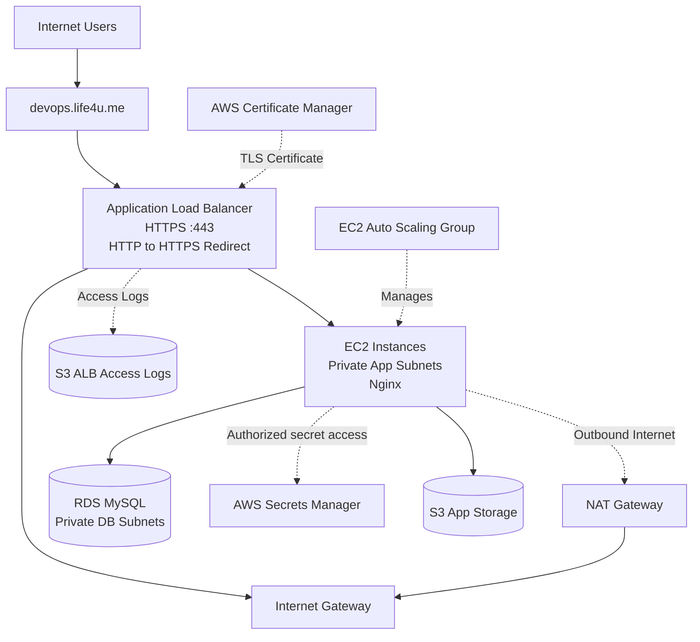

# AWS DevOps Assessment — Architecture

## Overview

The infrastructure is provisioned using Terraform in AWS Mumbai (`ap-south-1`).

## Architecture Diagram

## Network Design

- One VPC with CIDR `10.0.0.0/16`.
- Two public subnets for internet-facing infrastructure.
- Two private application subnets for EC2 instances.
- Two private database subnets for RDS.
- Internet Gateway for public subnet connectivity.
- NAT Gateway for outbound connectivity from private application subnets.
- Security groups restrict application and database traffic.

## Request Flow

1. A user visits `https://devops.life4u.me`.
2. DNS directs the request to the Application Load Balancer.
3. The ALB terminates HTTPS using the ACM certificate.
4. The ALB forwards requests to healthy EC2 targets over HTTP.
5. Nginx serves the demo application from the private EC2 instances.

## Database and Storage

- RDS MySQL is configured as a private database.
- Database credentials are stored in AWS Secrets Manager.
- An EC2 IAM role permits access to the configured database secret.
- S3 buckets provide application storage and ALB access-log storage.

**Important:** The current demo page is static. The diagram shows configured infrastructure relationships and intended capabilities; it does not mean the demo application currently queries RDS or reads Secrets Manager credentials.

## CI Workflow

GitHub Actions performs Terraform formatting checks, initialization, and validation. Infrastructure provisioning is performed separately; the current workflow does not automatically run `terraform apply`.

## Verification

- HTTPS website accessible.
- HTTP redirects to HTTPS.
- ALB target group reports one healthy target.
- RDS is not publicly accessible.
- Terraform state tracks the main infrastructure resources.
